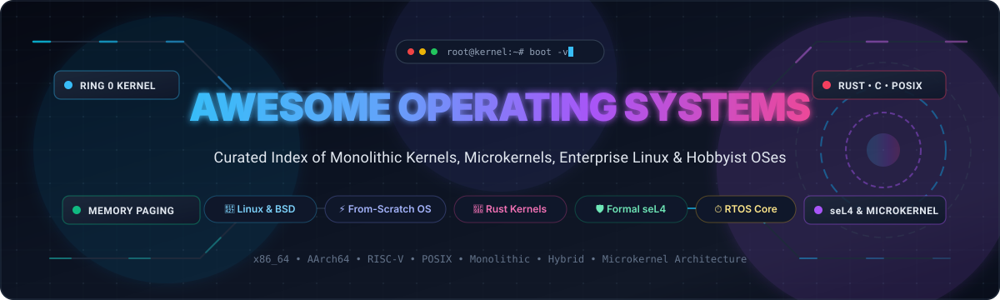
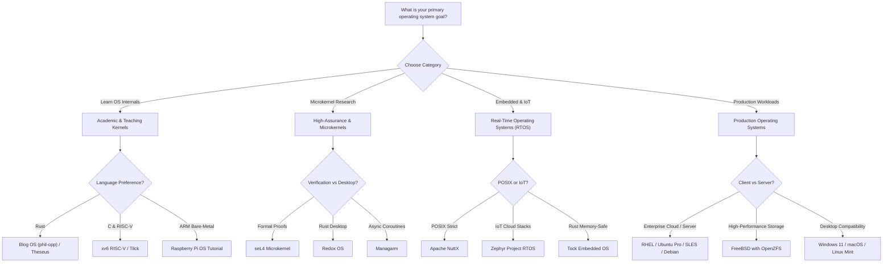
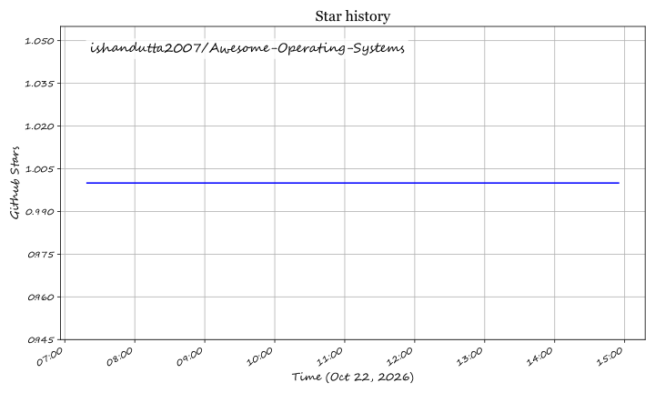

<div align="center">



# ⚡ Awesome Operating Systems 💻

### *Curated Directory of Kernel Architectures, Enterprise Linux, Hobbyist OSes & Systems Programming*
**Monolithic Kernels • Microkernels • Memory-Safe Rust OS • Real-Time Operating Systems (RTOS) • POSIX Standards**

<p align="center">
  <a href="https://github.com/ishandutta2007/Awesome-Awesome-Awesome"></a>
  <a href="https://discord.gg/jc4xtF58Ve"></a>
  <a href="https://github.com/ishandutta2007/Awesome-Operating-Systems/stargazers"></a>
  <a href="https://github.com/ishandutta2007/Awesome-Operating-Systems/network/members"></a>
  <a href="https://opensource.org/licenses/MIT"></a>
  <a href="http://makeapullrequest.com"></a>
  <a href="https://github.com/ishandutta2007/Awesome-Operating-Systems/graphs/commit-activity"></a>
  <a href="https://github.com/ishandutta2007"></a>
</p>

</div>

---

## 📖 Introduction & Technical Context

Welcome to the **Awesome Operating Systems** repository — an authoritative, SEO-indexed, and community-maintained technical index of foundational system software. An **Operating System (OS)** acts as the critical bridge between raw computational silicon (CPU, MMU, APIC, DMA, NVMe) and higher-level userland application software. 

Core operating system design centers around fundamental abstractions:
* 🧠 **Virtual Memory Management (VMM) & Paging**: Translating virtual addresses to physical pages via multilevel page tables (CR3/TTBR0), handling Translation Lookaside Buffer (TLB) shootdowns, and enforcing Ring 0/Ring 3 access controls.
* ⚙️ **Process & Thread Scheduling**: Implementing preemptive multitasking, cooperative yielding, context switching (saving/restoring register state), and fairness policies (CFS, EEVDF, MLFQ, strict real-time deadline scheduling).
* 🛡️ **Kernel Architecture Paradigms**:
  * **Monolithic**: Drivers, filesystems, and network stacks reside within the high-privilege kernel space for maximum throughput and zero-copy data paths (e.g., Linux, FreeBSD).
  * **Microkernel**: Minimalist Ring 0 kernel providing solely address spaces, threads, and Inter-Process Communication (IPC); drivers and filesystems execute in isolated user-space servers (e.g., seL4, Redox, Managarm).
  * **Hybrid & Framework Kernels**: Balancing user-space modularity with selected kernel-space acceleration (e.g., Windows NT, macOS XNU, Asterinas).
* 🔒 **Memory Safety & Modern Languages**: The transition from legacy C/Assembly toward memory-safe systems languages (Rust) to eliminate spatial/temporal memory corruption bugs, buffer overflows, and use-after-free vulnerabilities at the bare-metal layer.

Whether you are building an educational kernel from scratch, optimizing Linux production servers, or designing formally verified microkernels for mission-critical aerospace hardware, this directory curates the state-of-the-art across SaaS platforms, enterprise distributions, and open-source GitHub projects.

---

## 📑 Table of Contents

- [🌐 Sector Overview & Market Dynamics](#-sector-overview--market-dynamics)
- [🏢 Enterprise Commercial & SaaS Operating Systems](#-enterprise-commercial--saas-operating-systems)
- [🚀 Top Open-Source Operating Systems & Kernels](#-top-open-source-operating-systems--kernels)
- [🐧 Iconic Linux & BSD Distribution Ecosystem](#-iconic-linux--bsd-distribution-ecosystem)
- [📊 Architectural Comparison Matrix](#-architectural-comparison-matrix)
- [💡 Architectural Decision Guide](#-architectural-decision-guide)
- [❓ Frequently Asked Questions (FAQ)](#-frequently-asked-questions-faq)
- [🤝 How to Contribute](#-how-to-contribute)
- [##  Star History](#--star-history)
- [💖 Support & Sponsoring](#-support--sponsoring)
- [📄 License & Disclaimer](#-license--disclaimer)

---

## 🌐 Sector Overview & Market Dynamics

The global **Operating Systems (OS) Market** was valued at approximately **$50.5 Billion in 2024–2025** and is projected to surpass **$78.2+ Billion by 2032**, expanding at a Compound Annual Growth Rate (CAGR) of **~5.6%**, accelerated by the expansion of hyperscale cloud infrastructure, edge-computing nodes, enterprise cloud-native container workloads, and embedded automotive/IoT silicon.

The competitive landscape demonstrates a stark **two-tier concentration dynamic**:
* **Client & End-User Operating Systems (High Concentration / Winner-Takes-All Oligopoly)**: The consumer and enterprise desktop ecosystem is heavily concentrated. **Microsoft Windows commands ~70–72% of global desktop market share**, while **Apple macOS retains ~15–18%**, forming an entrenched duopoly protected by high switching costs, proprietary enterprise management frameworks (Active Directory, Intune, Apple MDM), and deep desktop software ecosystem lock-in. Similarly, mobile client OS endpoints are virtually 100% consolidated between **Google Android** and **Apple iOS**.
* **Cloud, Server & Embedded Infrastructure (Open Standards & Linux Dominance)**: In data centers, hyperscale clouds (AWS, Azure, GCP), supercomputers, and container runtimes, the sector is overwhelmingly powered by open-source Unix-like architectures. **Linux accounts for >90% of public cloud instances and 100% of the TOP500 world supercomputers**. Here, value capture shifts toward commercial support, enterprise compliance, and certified stability (e.g., Red Hat Enterprise Linux, SUSE, Ubuntu Pro), while the cutting edge of OS research is characterized by thriving open-source experimentation in memory-safe Rust kernels (Redox, Asterinas) and formally verified microkernels (seL4).

---

## 🏢 Enterprise Commercial & SaaS Operating Systems

The following commercial operating system platforms provide enterprise support agreements, certified driver ecosystems, long-term compliance validation, and managed cloud-desktop runtimes.

> **Sorted by Company Scale / Valuation (Descending)**

| 🏢 Platform | 💰 Company Scale / Valuation | ⚙️ Architecture & Enterprise Capabilities | 💵 Starting Tier Pricing | 🎁 Free Tier / Trial Limits |
|:---|:---|:---|:---|:---|
| [**Apple macOS**](https://www.apple.com/macos/) | **~$3.4 Trillion Market Cap** / ~$383B Annual Revenue (NASDAQ: `AAPL`) | Proprietary Unix 03-certified desktop/workstation OS built atop the hybrid **XNU kernel** (Mach microkernel primitives + FreeBSD POSIX subsystem). Tightly optimized for Apple Silicon (M-series ARM64) with unified memory, Metal 3 API, and FileVault 2 encryption. | **$0.00 base OS license** (Perpetual free updates bundled exclusively with Apple Mac hardware starting at **$599.00 one-time** for Mac mini M4 or $999.00 for MacBook Air). | **Free Forever with Mac Hardware**: Zero recurring subscriptions or upgrade fees; lifetime access to major OS updates, security patches, and full developer toolchain (Xcode) for the device lifecycle (~7 years). |
| [**Microsoft Windows / Windows 365**](https://www.microsoft.com/windows) | **~$3.1 Trillion Market Cap** / ~$245B Annual Revenue (NASDAQ: `MSFT`) | Dominant enterprise desktop and workstation OS powered by the **Windows NT hybrid kernel**. Features the Win32 API, Windows Subsystem for Linux (WSL2), Hyper-V virtualization, BitLocker, and seamless Azure Entra ID / Intune integration. | **$139.00 one-time license** for Windows 11 Home ($199.99 for Windows 11 Pro); Cloud-hosted Windows 365 Cloud PC starts at **$28.00/user/month** (1 vCPU, 2 GB RAM, 64 GB storage). | **90-Day Free Evaluation Edition**: Full-featured Windows 11 Enterprise ISO evaluation available for **90 days** for testing; unactivated retail installations allow indefinite local use with personalization settings disabled and desktop watermark. |
| [**Google ChromeOS Enterprise & Flex**](https://chromeenterprise.google/os/) | **~$2.2 Trillion Market Cap** / ~$350B Annual Revenue (NASDAQ: `GOOGL`) | Cloud-native, secure operating system based on Linux. Leverages sandboxed execution, read-only system partitions, verified boot, automated background patching, and optional Linux container development environments (Crostini). | **$0.00 standalone OS** (ChromeOS Flex is free to flash onto any x86 PC/Mac); ChromeOS Enterprise Upgrade cloud management license starts at **$50.00/device/year** (or $30/device/year for education). | **Free Forever Plan**: ChromeOS Flex is **100% free forever** for unlimited personal/enterprise endpoints without centralized cloud fleet management; Chrome Enterprise Upgrade includes a **30-Day Free Trial** with up to 50 device management licenses. |
| [**Red Hat Enterprise Linux (RHEL)**](https://www.redhat.com/en/technologies/linux-platforms/enterprise-linux) | **~$210 Billion Market Cap** (IBM: NYSE: `IBM` / Red Hat ~$6.5B ARR) | The gold standard for mission-critical enterprise Linux. Features SELinux mandatory access controls, live kernel patching (`kpatch`), enterprise hardware certifications, and a guaranteed 10-year support lifecycle with extended update support (EUS). | **$179.00/year** (RHEL Workstation Self-Support); RHEL Server Entry/Self-Support starts at **$349.00/year** ($799.00/year for Standard 8x5 business hours support; $1,299.00/year for Premium 24x7 support). | **Free Forever Developer Subscription**: Zero-cost subscription covering up to **16 physical or virtual system nodes** for individual development and production workloads with access to full RHEL errata and repos; plus a **60-Day Evaluation Trial** for multi-server enterprise testing. |
| [**SUSE Linux Enterprise Server (SLES)**](https://www.suse.com/products/server/) | **~$3.0 Billion Valuation** (~$670M Annual Revenue) | Highly reliable, scalable server operating system tailored for SAP HANA, high-performance computing (HPC), and enterprise Kubernetes infrastructure (Rancher integration). Provides YaST systems management and live kernel patching. | **$799.00/year** (SLES Basic 1–2 sockets or 1–2 VMs with self-service maintenance); Standard 12x5 support tier starts at **$1,199.00/year** per server socket pair. | **60-Day Free Trial**: Fully unrestricted 60-day enterprise evaluation license providing complete access to binary packages, security updates, YaST configuration modules, and SUSE Customer Center repositories. |
| [**Canonical Ubuntu Pro**](https://ubuntu.com/pro) | **~$251 Million Annual Revenue** (Private / Canonical Ltd.) | Comprehensive enterprise compliance and security maintenance subscription for Ubuntu LTS releases. Extends security coverage to 30,000+ packages in Main and Universe repositories, provides automated Kernel Livepatch, and delivers FIPS 140-3 cryptography. | **$25.00/desktop/year** or **$500.00/server/year** (Ubuntu Pro subscription with 10–12 years Extended Security Maintenance [ESM] and 24x7 enterprise ticket support available as add-on). | **Free Forever Tier**: Free forever for personal and non-commercial use on up to **5 machines** (expanded to up to 50 machines for official Ubuntu community contributors), providing full access to livepatching and ESM security updates. |

---

## 🚀 Top Open-Source Operating Systems & Kernels

Discover the premier open-source operating systems, from-scratch monolithic kernels, memory-safe Rust OS implementations, and formally verified microkernels.

> **Sorted by GitHub_Stars (Descending)**

### 1. [Linux Kernel](https://github.com/torvalds/linux) [](https://github.com/torvalds/linux/stargazers)
* **GitHub Repository**: [torvalds/linux](https://github.com/torvalds/linux) • **License**: GPL-2.0 • **Core Language**: C / Assembly / Rust
* 🌟 **Key Architectural Highlights**:
  - The monolithic Unix-like kernel powering the modern internet, hyperscale cloud clusters, Android smartphones, embedded systems, and 100% of the world's top 500 supercomputers.
  - Implements preemptive multitasking, advanced virtual memory management, cgroups v2 resource accounting, namespaces for container isolation, eBPF in-kernel programmable bytecode execution, and the Completely Fair Scheduler (CFS) / Earliest Eligible Virtual Deadline First (EEVDF).
  - Extensive hardware support across virtually every major CPU architecture (x86_64, AArch64, RISC-V, MIPS, PowerPC, s390x, LoongArch).
* 🎯 **Best For**: Production cloud infrastructure, enterprise servers, containers, desktop distributions, and high-performance embedded systems.

---

### 2. [SerenityOS](https://github.com/SerenityOS/serenity) [](https://github.com/SerenityOS/serenity/stargazers)
* **GitHub Repository**: [SerenityOS/serenity](https://github.com/SerenityOS/serenity) • **License**: BSD-2-Clause • **Core Language**: C++
* 🌟 **Key Architectural Highlights**:
  - A love letter to 1990s graphical user interfaces with a custom Unix-like core, built entirely from scratch in modern C++ without any third-party dependencies.
  - Complete vertical integration: includes a custom 64-bit preemptive multitasking kernel, WindowServer compositor, AudioServer, native GUI toolkit (LibGUI), HackStudio IDE, and the original foundation of the Ladybird browser engine (LibWeb/LibJS).
  - Modern security primitives baked into the architecture, including W^X memory policies, `pledge` and `unveil` sandboxing system calls, ASLR, and kernel address isolation.
* 🎯 **Best For**: Systems programmers and OS enthusiasts looking for an approachable, hackable, fully self-contained desktop OS running on real x86_64 hardware and QEMU.

---

### 3. [ReactOS](https://github.com/reactos/reactos) [](https://github.com/reactos/reactos/stargazers)
* **GitHub Repository**: [reactos/reactos](https://github.com/reactos/reactos) • **License**: GPL-2.0 / LGPL-2.1 • **Core Language**: C / C++
* 🌟 **Key Architectural Highlights**:
  - An open-source, clean-room reimplementation of the Windows NT operating system architecture, aiming for binary compatibility with Windows applications and device drivers.
  - Features a custom NT-compatible Executive and Kernel (ntoskrnl.exe), Object Manager, Process/Thread Manager, I/O Subsystem, Win32k GDI/USER graphics subsystem, and Hardware Abstraction Layer (HAL).
  - Integrates components with the Wine project to execute Win32 and DirectX applications natively on x86 hardware without a hypervisor.
* 🎯 **Best For**: Running legacy Windows software on open-source infrastructure, OS developers studying Windows internal architecture, and clean-room systems engineering.

---

### 4. [Writing an OS in Rust (Blog OS)](https://github.com/phil-opp/blog_os) [](https://github.com/phil-opp/blog_os/stargazers)
* **GitHub Repository**: [phil-opp/blog_os](https://github.com/phil-opp/blog_os) • **License**: MIT / Apache-2.0 • **Core Language**: Rust
* 🌟 **Key Architectural Highlights**:
  - The gold standard pedagogical tutorial and kernel codebase created by Philipp Oppermann, demonstrating how to write an x86_64 operating system kernel in Rust from scratch.
  - Walks through bare-metal `#![no_std]` programming, VGA text buffer output, CPU exception handling via Interrupt Descriptor Tables (IDT), Global Descriptor Tables (GDT), 4-level paging memory management, heap allocators, and cooperative/preemptive multitasking.
  - Leverages Rust's compile-time type system and ownership semantics to guarantee safety against null pointer dereferences and data races in kernel mode.
* 🎯 **Best For**: Developers learning operating systems engineering, systems programming in Rust, and computer architecture fundamentals.

---

### 5. [Zephyr Project RTOS](https://github.com/zephyrproject-rtos/zephyr) [](https://github.com/zephyrproject-rtos/zephyr/stargazers)
* **GitHub Repository**: [zephyrproject-rtos/zephyr](https://github.com/zephyrproject-rtos/zephyr) • **License**: Apache-2.0 • **Core Language**: C
* 🌟 **Key Architectural Highlights**:
  - A scalable, safe, and secure real-time operating system (RTOS) hosted by the Linux Foundation, engineered specifically for resource-constrained IoT endpoints and embedded microcontrollers.
  - Modular kernel architecture supporting multi-threading, preemptive priority-based scheduling, cooperative scheduling, static memory allocation, and power management.
  - Comprehensive out-of-the-box connectivity stacks: native Bluetooth Low Energy (BLE 5.3), Wi-Fi, Thread, 6LoWPAN, CoAP, and LwM2M, configured seamlessly via Devicetree and Kconfig.
* 🎯 **Best For**: Industrial IoT, smart home hardware, wearable devices, and embedded microcontrollers (ARM Cortex-M, RISC-V, ESP32).

---

### 6. [Redox OS](https://github.com/redox-os/redox) [](https://github.com/redox-os/redox/stargazers)
* **GitHub Repository**: [redox-os/redox](https://github.com/redox-os/redox) • **License**: MIT • **Core Language**: Rust
* 🌟 **Key Architectural Highlights**:
  - A modern, Unix-like microkernel operating system written from the ground up in Rust, designed around memory safety, modularity, and principle of least privilege.
  - Clean microkernel design: drivers, filesystems (RedoxFS with copy-on-write integrity), and networking operate entirely in unprivileged user space, communicating via URL-like scheme abstractions and IPC.
  - Features its own POSIX-compatible standard C library (`relibc`), package manager (`pkgutils`), and desktop environment (`Orbital`).
* 🎯 **Best For**: Systems engineers seeking a secure, memory-safe alternative to classical Unix monolithic kernels, and modern microkernel research.

---

### 7. [Raspberry Pi OS Kernel & Tutorial](https://github.com/s-matyukevich/raspberry-pi-os) [](https://github.com/s-matyukevich/raspberry-pi-os/stargazers)
* **GitHub Repository**: [s-matyukevich/raspberry-pi-os](https://github.com/s-matyukevich/raspberry-pi-os) • **License**: MIT • **Core Language**: C / Assembly
* 🌟 **Key Architectural Highlights**:
  - Practical, step-by-step educational operating system built directly for the 64-bit ARMv8-A architecture on Raspberry Pi 3 and 4 hardware.
  - Explores low-level ARM concepts: processor initialization, switching Execution Levels (EL3/EL2 to EL1 kernel mode), mini UART communication, timer interrupts, virtual memory translation via translation tables, and preemptive task scheduling.
  - Highly readable code structure comparing each subsystem step against the corresponding implementation inside the upstream Linux kernel.
* 🎯 **Best For**: Engineers and students learning 64-bit ARM architecture, embedded bare-metal firmware development, and low-level kernel initialization.

---

### 8. [xv6 RISC-V](https://github.com/mit-pdos/xv6-riscv) [](https://github.com/mit-pdos/xv6-riscv/stargazers)
* **GitHub Repository**: [mit-pdos/xv6-riscv](https://github.com/mit-pdos/xv6-riscv) • **License**: MIT • **Core Language**: C
* 🌟 **Key Architectural Highlights**:
  - MIT's modern pedagogical operating system reimplemented for the open 64-bit RISC-V instruction set architecture (used in MIT's 6.1810 / 6.828 Operating System Engineering course).
  - Faithful to the design principles of Dennis Ritchie and Ken Thompson's classic Unix Version 6 (v6), but adapted to modern multiprocessor systems with RISC-V page tables and hardware interrupts.
  - Implements the complete foundational Unix surface: process lifecycles (`fork`, `exec`, `wait`), pipe IPC, sleep/wakeup synchronization, trap handling, spinlocks, and a crash-resilient logging filesystem in under 10,000 lines of code.
* 🎯 **Best For**: Academic study, computer science students, and programmers wanting a complete, end-to-end understanding of an operating system kernel.

---

### 9. [FreeBSD](https://github.com/freebsd/freebsd-src) [](https://github.com/freebsd/freebsd-src/stargazers)
* **GitHub Repository**: [freebsd/freebsd-src](https://github.com/freebsd/freebsd-src) • **License**: BSD-2-Clause • **Core Language**: C
* 🌟 **Key Architectural Highlights**:
  - A mature, production-grade Unix-like operating system descending directly from UC Berkeley's Computer Systems Research Group (CSRG) BSD releases.
  - Renowned for its industry-leading networking stack, serving multi-terabit edge traffic at Netflix and powering enterprise storage appliances at TrueNAS.
  - Native integration with the OpenZFS enterprise filesystem, lightweight OS-level virtualization via **FreeBSD Jails**, Capsicum capability-based sandboxing, and the `bhyve` hypervisor.
* 🎯 **Best For**: High-throughput storage appliances, internet edge routers, firewalls (pfSense/OPNsense), mission-critical servers, and BSD systems research.

---

### 10. [ToaruOS](https://github.com/klange/toaruos) [](https://github.com/klange/toaruos/stargazers)
* **GitHub Repository**: [klange/toaruos](https://github.com/klange/toaruos) • **License**: NCSA / UIUC • **Core Language**: C / Python
* 🌟 **Key Architectural Highlights**:
  - A complete, clean-slate hobby operating system designed and maintained by K. Lange since 2011.
  - Features the custom **Misaka hybrid kernel** supporting x86_64, a modular dynamic linker (`ld.so`), custom standard C library, and a full graphical desktop environment.
  - Includes **Yutani** (compositing window manager with window animations and desktop wallpaper), **Kuroko** (dynamic bytecode-compiled language), **Bim** (Vim-inspired editor), and ports of GCC, Python, and Doom.
* 🎯 **Best For**: OS development learners seeking a complete from-scratch system with clear component boundaries, Docker-based build toolchains, and a graphical userspace.

---

### 11. [Tock Embedded OS](https://github.com/tock/tock) [](https://github.com/tock/tock/stargazers)
* **GitHub Repository**: [tock/tock](https://github.com/tock/tock) • **License**: Apache-2.0 / MIT • **Core Language**: Rust
* 🌟 **Key Architectural Highlights**:
  - An embedded operating system written in Rust designed for running multiple concurrent, mutually untrusted applications on resource-constrained microcontrollers (ARM Cortex-M and RISC-V).
  - Uses Rust's type system to enforce memory and fault isolation between device drivers within the kernel without requiring hardware MMU paging.
  - User applications execute in unprivileged user space (isolated via hardware Memory Protection Units [MPU]), enabling non-volatile storage isolation and cooperative low-power scheduling.
* 🎯 **Best For**: Secure IoT sensor networks, cryptographic hardware tokens (such as OpenSK security keys), and low-power embedded edge platforms.

---

### 12. [seL4 Microkernel](https://github.com/seL4/seL4) [](https://github.com/seL4/seL4/stargazers)
* **GitHub Repository**: [seL4/seL4](https://github.com/seL4/seL4) • **License**: GPL-2.0 • **Core Language**: C / Isabelle/HOL
* 🌟 **Key Architectural Highlights**:
  - The world's fastest and most comprehensively formally verified microkernel, backed by mathematical proofs in the Isabelle/HOL theorem prover.
  - Guarantees complete spatial isolation, integrity, confidentiality, and temporal fault containment; proven free of buffer overflows, null pointer dereferences, and memory leaks.
  - Implements a pure capability-based security model: every system resource (threads, memory frames, page tables, endpoints) is managed via unforgeable capability tokens.
* 🎯 **Best For**: High-assurance defense systems, avionics, autonomous automotive vehicles, medical devices, and mission-critical microkernel infrastructure.

---

### 13. [Asterinas](https://github.com/asterinas/asterinas) [](https://github.com/asterinas/asterinas/stargazers)
* **GitHub Repository**: [asterinas/asterinas](https://github.com/asterinas/asterinas) • **License**: MPL-2.0 • **Core Language**: Rust
* 🌟 **Key Architectural Highlights**:
  - A modern, safe, and general-purpose OS kernel written in Rust from scratch, pioneering the "framekernel" architecture to structurally isolate and minimize `unsafe` Rust.
  - Delivers high Linux binary compatibility, allowing unmodified Linux applications, glibc/musl runtimes, and OCI containers to execute directly atop a memory-safe kernel foundation.
  - Native support for x86_64, RISC-V, and AArch64 hardware platforms with high-throughput virtual memory paging and async I/O.
* 🎯 **Best For**: Cloud-native secure micro-VMs, safe container infrastructure, and next-generation memory-safe operating system deployment.

---

### 14. [Apache NuttX](https://github.com/apache/nuttx) [](https://github.com/apache/nuttx/stargazers)
* **GitHub Repository**: [apache/nuttx](https://github.com/apache/nuttx) • **License**: Apache-2.0 • **Core Language**: C
* 🌟 **Key Architectural Highlights**:
  - A real-time operating system with strict adherence to POSIX and ANSI standards, scaling seamlessly from 8-bit microcontrollers to 64-bit multi-core architectures.
  - Supports three distinct build modes: Flat Mode (single address space), Protected Mode (MPU-enforced separation between kernel and user tasks), and Kernel Mode (full MMU virtual memory paging).
  - Widely deployed in production avionics, including the PX4 Autopilot system for autonomous drones, smart watches, and industrial automation equipment.
* 🎯 **Best For**: Drone flight controllers, industrial robotics, smart consumer electronics, and POSIX-compliant embedded engineering.

---

### 15. [Theseus OS](https://github.com/theseus-os/Theseus) [](https://github.com/theseus-os/Theseus/stargazers)
* **GitHub Repository**: [theseus-os/Theseus](https://github.com/theseus-os/Theseus) • **License**: MIT • **Core Language**: Rust
* 🌟 **Key Architectural Highlights**:
  - A clean-slate research operating system written in Rust, reimagining the structural boundaries of system software.
  - Completely eliminates the traditional boundary between kernel space and user space: the entire OS consists of tiny, single-purpose software modules called "cells" running in a single address space at Ring 0.
  - Compiler-enforced invariants guarantee safety and fault isolation; cells can be dynamically reloaded, updated, or replaced at runtime without rebooting the system.
* 🎯 **Best For**: Advanced operating systems research, dynamic software updating, and language-enforced operating system architectures.

---

### 16. [Tilck](https://github.com/vvaltchev/tilck) [](https://github.com/vvaltchev/tilck/stargazers)
* **GitHub Repository**: [vvaltchev/tilck](https://github.com/vvaltchev/tilck) • **License**: BSD-2-Clause • **Core Language**: C
* 🌟 **Key Architectural Highlights**:
  - A tiny, Linux-compatible monolithic kernel built from scratch for educational clarity, embedded micro-VMs, and fast boot times.
  - Implements the Linux system call interface, allowing unmodified Linux user-space binaries (Busybox, Vim, Python, Micropython, Doom) to run directly without modification.
  - Deliberately engineered to be ~100x smaller and vastly simpler to read and debug than the upstream Linux kernel, making it an ideal stepping stone between teaching OSes and Linux.
* 🎯 **Best For**: Developers wishing to study Linux kernel internals through a clean, readable implementation, and ultra-fast booting micro-VMs.

---

### 17. [Haiku OS](https://github.com/haiku/haiku) [](https://github.com/haiku/haiku/stargazers)
* **GitHub Repository**: [haiku/haiku](https://github.com/haiku/haiku) • **License**: MIT • **Core Language**: C++
* 🌟 **Key Architectural Highlights**:
  - An open-source desktop operating system inspired by BeOS, specifically architected and optimized for responsive personal computing and multimedia creation.
  - Highly multi-threaded architecture with clean object-oriented C++ APIs; every window and desktop element operates on independent lightweight threads for zero interface stutter.
  - Custom database-like filesystem (**BFS**) with rich indexed metadata attributes, enabling instantaneous file querying, filtering, and tagged desktop file organization.
* 🎯 **Best For**: Dedicated audio/video workstations, vintage computing fans, and desktop enthusiasts seeking a fast, lightweight alternative to Windows and Linux.

---

### 18. [Managarm](https://github.com/managarm/managarm) [](https://github.com/managarm/managarm/stargazers)
* **GitHub Repository**: [managarm/managarm](https://github.com/managarm/managarm) • **License**: MIT • **Core Language**: C++
* 🌟 **Key Architectural Highlights**:
  - A pragmatic microkernel-based operating system designed for x86_64 and AArch64 modern PCs.
  - Built from the ground up around an asynchronous, non-blocking I/O and Inter-Process Communication (IPC) architecture powered by C++20 coroutines.
  - Implements POSIX compatibility via the `mlibc` library, successfully running standard desktop software including the Weston Wayland compositor, Mesa graphics acceleration, and GNU toolchains.
* 🎯 **Best For**: Modern microkernel research with real hardware graphics acceleration, asynchronous systems programming, and high-performance IPC.

---

## 🐧 Iconic Linux & BSD Distribution Ecosystem

While the repositories above focus on kernels and core systems code, complete distributions provide package management, userland toolchains, desktop environments, and server fleets:

* 📦 **[Debian](https://www.debian.org/)** — The foundational "universal operating system" created by Ian Murdock in 1993. Features three distinct release branches (Stable, Testing, Unstable), rock-solid `apt`/`dpkg` package management, and multi-architecture support spanning x86, ARM, MIPS, and RISC-V.
* 🟠 **[Ubuntu](https://ubuntu.com/)** — Canonical's Debian derivative that democratized Linux across desktops and cloud instances. Features 2-year LTS cadences, Snap package isolation, cloud images, and ubiquitous hardware driver compatibility.
* 🔵 **[Fedora](https://fedoraproject.org/)** — Red Hat's community-driven proving ground. Always at the forefront of upstream Linux technologies (systemd, Wayland, PipeWire, Btrfs, GNOME), offering Workstation, Server, CoreOS, and Silverblue immutable editions.
* 🏹 **[Arch Linux](https://archlinux.org/)** — Minimalist, rolling-release distribution adhering to the KISS principle. Gives users granular control over system configuration; backed by the lightweight `pacman` package manager and the comprehensive Arch User Repository (AUR).
* 🍃 **[Linux Mint](https://linuxmint.com/)** — Elegant, conservative desktop distribution featuring the Cinnamon desktop environment. Designed for effortless out-of-the-box productivity for users transitioning from Windows.
* 🐉 **[Kali Linux](https://www.kali.org/)** — Purpose-built security and penetration testing distribution from Offensive Security. Preloaded with 600+ forensic and offensive security auditing tools for cybersecurity professionals.
* 🐡 **[OpenBSD](https://www.openbsd.org/)** — Security-focused BSD operating system famed for pioneering proactive security mechanisms (`pledge`, `unveil`, W^X, ASLR, OpenSSH, LibreSSL) and uncompromising code correctness.

---

## 📊 Architectural Comparison Matrix

| Operating System / Kernel | 🏛️ Kernel Architecture | 💻 Primary Language | 🎯 Target Architectures | 📜 POSIX Compliance | 🔑 Core Defining Characteristic |
|:---|:---|:---|:---|:---|:---|
| **Linux Kernel** | Monolithic | C / Assembly / Rust | x86_64, AArch64, RISC-V, MIPS, s390x | Full POSIX | Universal cloud, enterprise server & mobile backbone |
| **SerenityOS** | Monolithic | C++ | x86_64 | Unix-like subset | Vertical 1990s desktop aesthetic with modern C++ core |
| **ReactOS** | Hybrid (NT clone) | C / C++ | x86, x86_64, ARM | Win32 / NT ABI | Native binary compatibility with Windows software & drivers |
| **Blog OS (Rust)** | Monolithic / Learning | Rust | x86_64 | None (Educational) | Clean compile-time memory-safe OS engineering tutorial |
| **Zephyr RTOS** | Modular RTOS | C | ARM Cortex-M, RISC-V, ESP32, x86 | Partial (Pthreads) | Highly scalable, low-power industrial IoT & connectivity |
| **Redox OS** | Microkernel | Rust | x86_64, AArch64 | High (via `relibc`) | Memory safety in Rust with user-space drivers & URL schemes |
| **xv6 RISC-V** | Monolithic / Teaching | C | RISC-V 64-bit | Core Unix v6 | Clear, concise pedagogical kernel under 10k lines of C |
| **FreeBSD** | Monolithic | C | x86_64, AArch64, PowerPC, RISC-V | Full POSIX | High-throughput networking stack, OpenZFS & Jails |
| **seL4** | Microkernel | C / Isabelle/HOL | ARM, x86, RISC-V | None (Capability IPC) | Formally verified correctness proofs & zero buffer overflows |
| **Asterinas** | Framekernel | Rust | x86_64, RISC-V, AArch64 | High (Linux ABI) | Safe framekernel architecture running unmodified Linux apps |
| **Apache NuttX** | Scalable RTOS | C | ARM, RISC-V, AVR, Xtensa | Strict POSIX | POSIX standards compliance on resource-constrained MCU silicon |
| **Theseus OS** | Cell-based Single Address | Rust | x86_64, AArch64 | Custom Cell ABI | Replaces user/kernel boundary with compiler-checked cells |
| **Tilck** | Monolithic | C | x86 (IA-32) | High (Linux syscalls) | 100x simpler, readable kernel executing Linux binaries |
| **Haiku** | Hybrid | C++ | x86_64, x86 | POSIX compliant | Responsive desktop multimedia computing with BFS database |
| **Managarm** | Microkernel | C++ | x86_64, AArch64 | High (via `mlibc`) | Asynchronous coroutine I/O & Wayland graphical acceleration |

---

## 💡 Architectural Decision Guide



---

## ❓ Frequently Asked Questions (FAQ)

<details>
<summary><strong>1. What is the fundamental difference between a Monolithic Kernel and a Microkernel?</strong></summary>

In a **monolithic kernel** (such as Linux or FreeBSD), virtually all fundamental operating system services—including virtual memory paging, process scheduling, IPC, hardware device drivers, network protocols, and filesystems—run together in a single privileged address space (Ring 0). This delivers maximum execution speed and zero-copy data passing, but a single bug in a device driver can trigger a fatal kernel panic (`BSOD` or `Kernel Oops`).

In a **microkernel** (such as seL4 or Redox), the kernel running in Ring 0 is stripped down to the bare essentials: thread management, virtual address space mapping, and Inter-Process Communication (IPC). All drivers, filesystems, and network stacks run as isolated processes in unprivileged user space (Ring 3). If a filesystem or GPU driver crashes, the microkernel restarts the crashed server process without bringing down the operating system.
</details>

<details>
<summary><strong>2. Why is Rust becoming prominent in modern operating systems development?</strong></summary>

Historically, operating systems were written exclusively in C and Assembly. However, Microsoft and Google security telemetry indicates that **~70% of all critical operating system vulnerabilities stem from memory safety bugs** (buffer overflows, use-after-free, double frees, data races). 

Rust provides compile-time ownership, borrow checking, and lifetimes, guaranteeing memory safety and thread safety without requiring a garbage collector. Projects like **Redox OS**, **Theseus**, **Asterinas**, and **Tock** demonstrate that complete operating systems can achieve bare-metal efficiency while preventing memory corruption exploits at compile time.
</details>

<details>
<summary><strong>3. What are CPU Privilege Rings (Ring 0 vs Ring 3)?</strong></summary>

Modern x86 and ARM processors enforce hierarchical privilege levels (Rings 0 through 3 on x86, or Exception Levels EL0 through EL3 on ARM64):
* **Ring 0 (Supervisor / Kernel Mode)**: Highest execution privilege. Code can execute privileged CPU instructions (such as disabling interrupts with `cli`, modifying control registers `CR0`/`CR3`/`CR4`, configuring page tables, and communicating directly with hardware I/O ports).
* **Ring 3 (User Mode)**: Restricted privilege where normal user applications execute. Software cannot directly access hardware or other process address spaces. To request services from the kernel, user applications execute a hardware trap instruction (`syscall` on x86_64, `svc` on ARM), transitioning execution safely into the kernel's registered syscall dispatch handlers.
</details>

<details>
<summary><strong>4. What is POSIX and why does it matter?</strong></summary>

**POSIX (Portable Operating System Interface)** is a family of IEEE and ISO standards defining the Application Programming Interface (API), shell interfaces, and utility conventions for Unix-like operating systems. By adhering to POSIX standards (such as system calls like `open`, `read`, `write`, `fork`, `exec`, and `pthread`), software written for one POSIX-compliant OS (like Linux, FreeBSD, macOS, or Apache NuttX) can be compiled and run on another with minimal code modification.
</details>

---

## 🤝 How to Contribute

Contributions are warmly welcomed! To contribute an open-source operating system project, kernel implementation, or enterprise distribution update:

1. 🍴 **Fork this repository** on GitHub.
2. 🌿 **Create a dedicated feature branch**:
   ```bash
   git checkout -b feature/add-operating-system-project
   ```
3. 📝 **Add or update your entry** in `README.md`:
   - Keep technical descriptions objective, factual, and informative.
   - For open-source projects, include the proper GitHub repository link and stargazer badge (`style=social&color=white`).
   - For commercial/SaaS platforms, provide exact starting tier prices and explicit free plan or evaluation limits.
4. 🚀 **Commit and submit a Pull Request**:
   ```bash
   git commit -m "Add [Project Name] to open-source operating systems section"
   git push origin feature/add-operating-system-project
   ```

---

##  Star History
[](https://star-history.dera.page/#ishandutta2007/Awesome-Operating-Systems&type=date&legend=top-left)

---

## 💖 Support & Sponsoring

If you find this curated Operating Systems ecosystem index educational, comprehensive, or useful for your projects:
* ⭐ **Star this repository** to improve its visibility and help other systems developers discover it!
* 🍴 **Fork the repo** and submit pull requests with new kernels, architectural comparisons, or benchmarks.
* 📢 **Share this repository** on Hacker News, Reddit (r/osdev, r/kernel, r/rust), X (Twitter), and LinkedIn.
* ☕ **Support Ongoing Maintenance**: You can sponsor this project directly or buy a coffee via the [GitHub Sponsors Dashboard](https://github.com/sponsors/ishandutta2007).

<div align="center">
  <a href="https://github.com/sponsors/ishandutta2007">
    
  </a>
</div>

---

## 📄 License & Disclaimer

* **License**: Released under the [MIT License](LICENSE).
* **Disclaimer**: This directory is an independent, community-curated educational index. Trademarks, logos, and product names belong to their respective corporate entities and foundation projects. Operating systems vary significantly in hardware driver support, maturity, and stability; hobbyist and educational kernels should be evaluated in virtual machine environments (QEMU, Bochs, VirtualBox) before deployment on bare-metal hardware.

---

<div align="center">
  <sub>Curated with ❤️ by <a href="https://github.com/ishandutta2007">Ishan Dutta</a> and the global systems engineering community.</sub>
</div>

## Star History

<a href="https://star-history.com/#ishandutta2007/Awesome-Operating-Systems&Timeline" align="center">
  <picture>
    <source media="(prefers-color-scheme: dark)" srcset="assets/ishandutta2007_Awesome-Operating-Systems_growth.svg">
    
  </picture>
</a>
